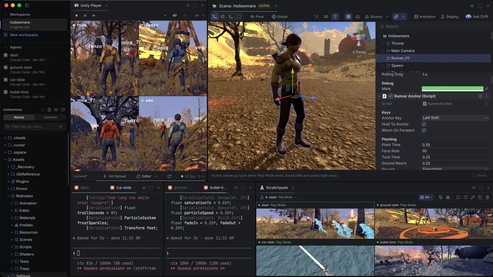

# Satura Space

[](https://github.com/saturadev/satura-space/actions/workflows/ci.yml)
[](https://github.com/saturadev/satura-space/actions/workflows/build.yml)
[](https://github.com/saturadev/satura-space/actions/workflows/phone-site.yml)
[](https://github.com/saturadev/satura-space/releases/latest)
[](https://github.com/saturadev/satura-space/releases)
[](https://github.com/saturadev/satura-space/releases/latest)
[](LICENSE)

**Your agent sets the stage. You tune the feel.**

Coding agents build your Unity game while it streams live beside them. When a value needs your eye,
they hand you Unity's real Inspector on just that.



Checking what an agent did to a Unity project usually means switching to the editor, pressing Play
and clicking through it yourself. Satura Space runs Claude Code, Codex, Cursor and other agents next
to hidden Unity editors that stream into the same window, so you play the game while the agents work,
without building a player.

## Download

Get the latest release from [GitHub Releases](https://github.com/saturadev/satura-space/releases/latest):
macOS on Apple Silicon (`.dmg`) or Windows x64 (`.exe`). The app updates itself from the same page.

You need Unity 6 with Unity Hub signed in, and a coding agent CLI on your PATH. Bring your own AI
subscription: Satura Space doesn't resell tokens or ask for an API key.

## What it does

- **The hand-off.** The agent sets up the moment, then opens a Tuner on what needs your eye: a small
  Unity editor in a panel with the hierarchy, a scene view, Unity's real Inspector and an animation
  timeline, in Edit or Play Mode. The rest of the scene goes gray. You tune it by feel, and Copy
  Changes hands your edits back to the agent.
- **Drift.** A small pixel jellyfish that shows you around. Ask the agent what something is, or press
  Ask Drift in a Tuner, and Drift flies the camera to it and points at the field to tweak.
- **Staging prefabs.** The agent puts one mechanic on a small set of its own and writes its scenarios
  in C#. Press ▶ in the Tuner to run them. When one fails, you see which check broke and on what line,
  with a chart of the run and the path it took.
- **Scratchpads.** Every agent gets its own Unity, so several build at once. Open a Tuner on any of
  them and tune it live.
- **Multiplayer clones.** Up to three clones run beside the primary editor, each with its own stream,
  console and input. They share your Library, so they boot in seconds.
- **One tool.** Other Unity bridges give the agent a catalog of tools, and every pick is another round
  trip. Satura Space registers one, `satura_exec`. The agent writes a few lines of JavaScript, and
  each line waits until its work is done, like Play starting or a video being saved. The same API
  opens Tuners and drives Drift, clips, scratchpads and the app itself.
- **Reports.** At the end of a feature the agent leaves a report beside its terminal: each check, the
  numbers before and after, and the recorded run.
- **C# hot reload.** Method bodies change in Play Mode without a domain reload.

The editors run hidden. Your keyboard and mouse reach the game through the stream, and when you want
the real window, reveal the editor: it's the same process, so nothing relaunches.

## Supported agents

Claude Code, Codex, Cursor, Grok Build, Kimi and opencode, whichever are on your PATH. Every terminal
is a real shell. Claude Code, Codex and Cursor get the Unity MCP server registered automatically.

## What it changes in your Unity project

Nothing you commit. The engine goes in as an embedded package (`Packages/com.saturaspace.engine`),
next to a `.sspace/` folder, an `Assets/csc.rsp` that defines `SATURA_SPACE`, and MCP registration for
your agents. The app lists all of them in `.git/info/exclude`, so git doesn't see them, and adds
nothing to `Packages/manifest.json` or `.gitignore` (it removes the `com.saturaspace.sdk` entry older
versions added). The engine stays out of player builds, and game
code that uses it sits inside `#if UNITY_EDITOR && SATURA_SPACE`, so a clone opens and builds in
plain Unity without Satura Space. Unity itself still records the engine in
`Packages/packages-lock.json`; a lock committed that way is harmless, and plain Unity drops the entry.

Outside the project, Codex gets the MCP server in `~/.codex/config.toml`, and Claude Code, Cursor,
Kimi and Grok Build get hooks in their config folders so the app can tell when an agent is working,
done or waiting for you.

## What works and what doesn't

| Works today | Not supported |
|---|---|
| Unity 6 with the Mono scripting backend, tested on 6000.6 and 6000.3 | Unity 2022 and 2021 LTS |
| Streamed input that works like Unity's Game View, for the Input System, uGUI, TextMeshPro and OnGUI | Input Manager (Old) or Both: the project won't launch until it uses the Input System |
| Hot reload of method bodies in Assembly-CSharp, asmdefs and embedded packages | Hot reload of new fields, methods and types (those take a normal recompile) |
| macOS on Apple Silicon, Windows x64 | Intel Macs, Linux |
| Claude Code, Codex and Cursor with the Unity MCP registered for them | MCP auto-registration for Grok Build, Kimi and opencode |

Blocked by something in the right column? Say so in an
[issue](https://github.com/saturadev/satura-space/issues/new/choose).

## Privacy

Everything runs on your machine, and you don't need an account (only Satura Remote does). There's
no telemetry and no crash reporting. Frames move over a shared GPU texture and everything else over
local loopback.

The app itself goes online to check GitHub Releases for updates. Other traffic comes from what you
run: your agents talk to their providers, the MCP
server downloads Unity's C# reference source from GitHub and reads Unity's Scripting Reference when
an agent asks for them, dashboard tiles fetch the URLs they're written to fetch, and the Kimi usage
meter asks Kimi's API with your own Kimi login. Satura Remote stays off until you turn it on to
pair a phone; from then on the app connects to the hosted relay (`relay.saturaspace.com`) and,
every few hours, checks the hosted phone app (`remote.saturaspace.com`) against its build attestation
on GitHub (`api.github.com`).

## Satura Remote

Satura Remote is a phone web app for tuning and checking on agents away from the desk. It runs in
the phone's browser at [remote.saturaspace.com](https://remote.saturaspace.com) or as a Home Screen
app. It's free when the phone is on the same Wi-Fi as the
desktop; over the internet it's a monthly subscription, managed at
[app.saturaspace.com](https://app.saturaspace.com). The desktop app stays free. The code is in
[`packages/companion-app`](packages/companion-app/README.md).

## Build from source

```bash
cd apps/orchestrator
corepack pnpm@10.34.9 install
corepack pnpm@10.34.9 dev
```

This needs Node 24 and pnpm 10, and Python 3.12 or newer for the MCP server. On Windows, build the
native helpers first. [CONTRIBUTING.md](CONTRIBUTING.md) covers both platforms, the repository layout,
the checks and the dev-instance workflow.

## Community

- Site: [saturaspace.com](https://saturaspace.com)
- X: [@saturadev](https://x.com/saturadev)
- Bugs: **Report a bug** in the app fills in your version and OS, or open an
  [issue](https://github.com/saturadev/satura-space/issues/new/choose).
- Security issues: see [SECURITY.md](SECURITY.md).

## License

[Apache-2.0](LICENSE), except the Satura Remote relay in `packages/companion-app`, which is under the
[Elastic License 2.0](packages/companion-app/LICENSE): use it, change it and run it for yourself, but
don't offer it to others as a hosted or managed service. Third-party code and assets keep their own
licenses, listed in [NOTICE](NOTICE).
